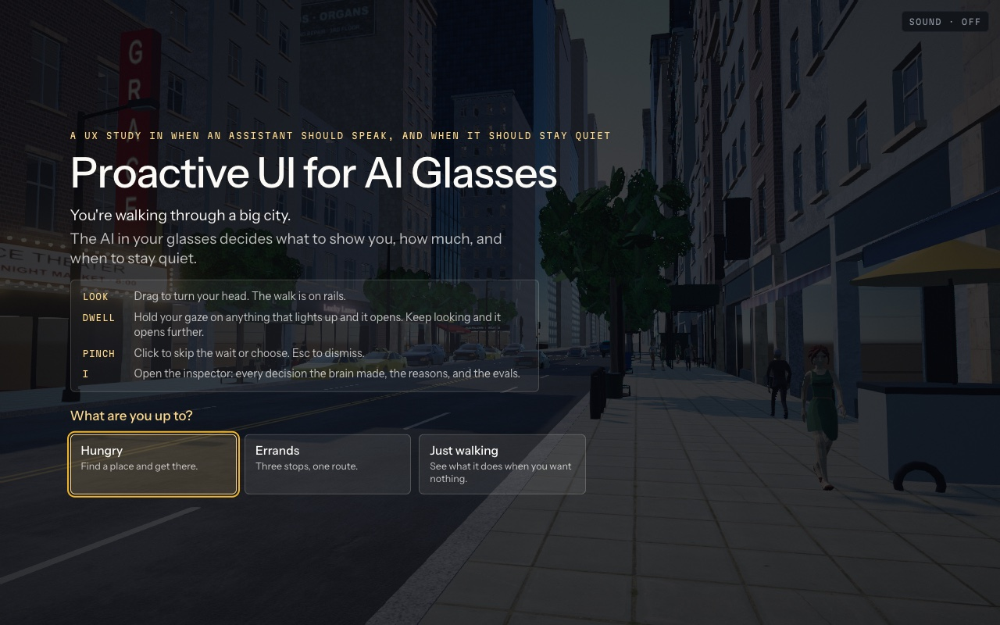
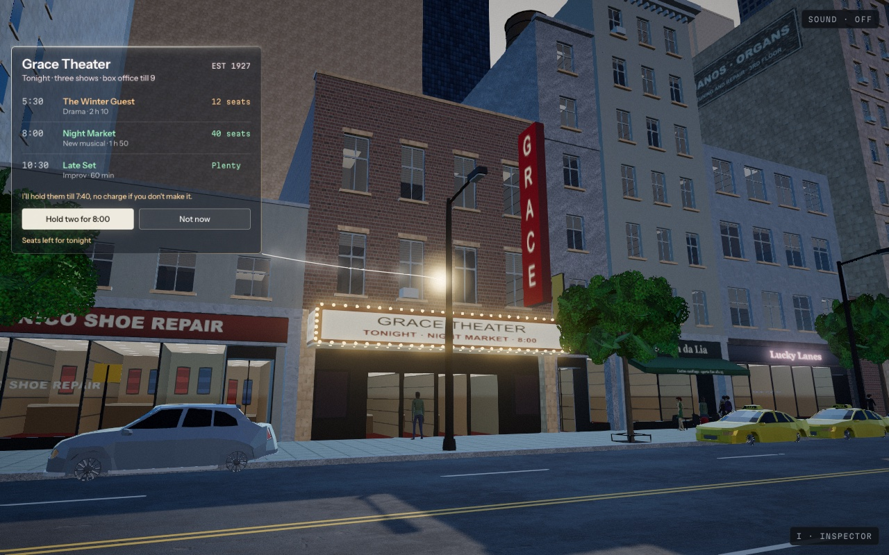
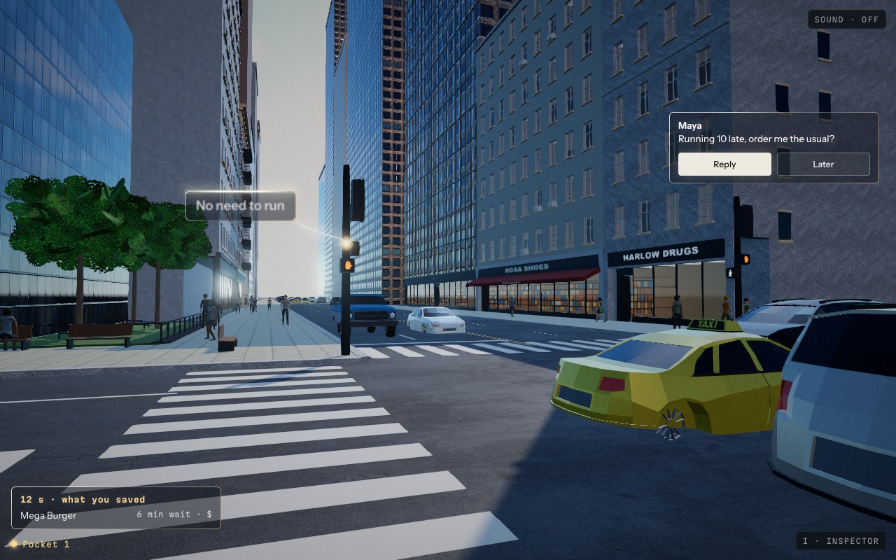
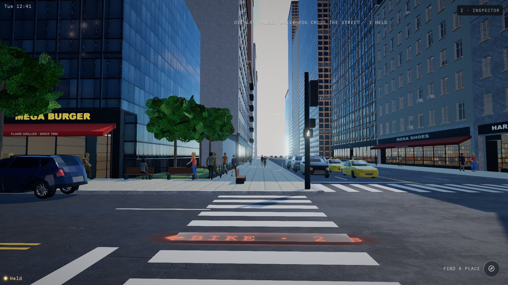
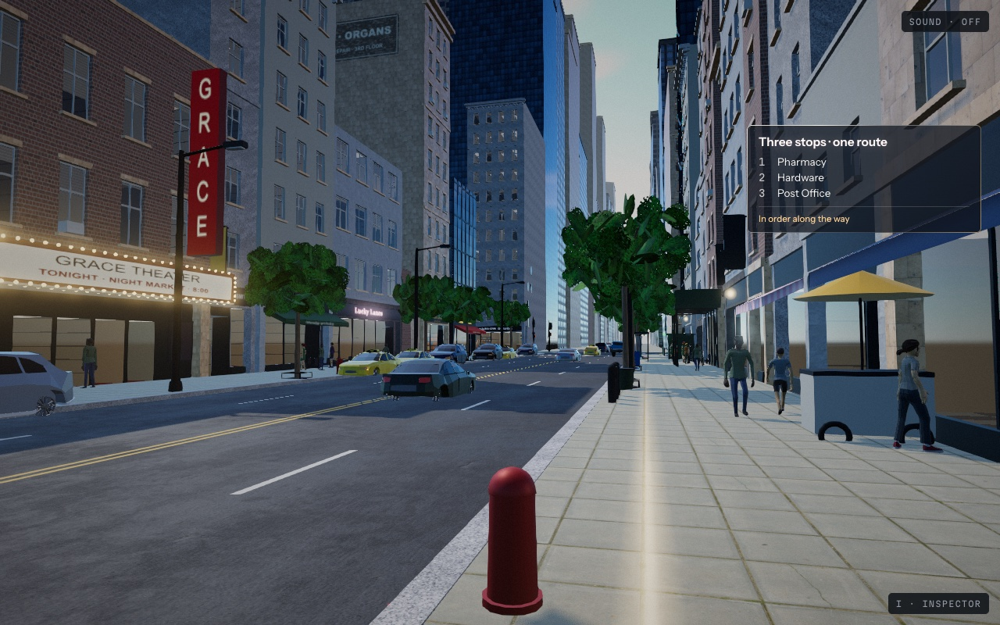
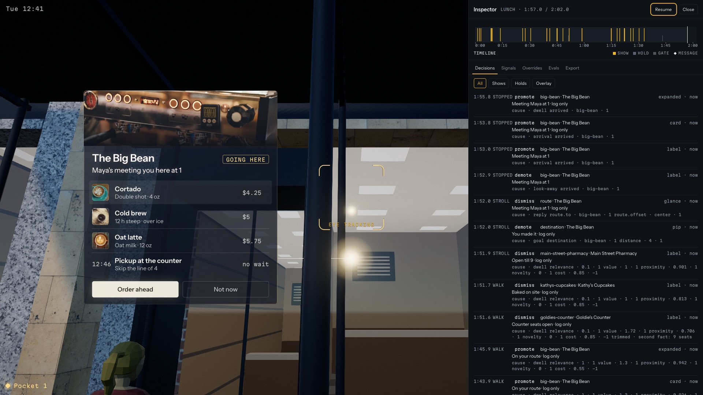

# Proactive UI for AI Glasses

*A UX study in when an assistant should speak, and when it should stay quiet.*

A simulated city street wired into a decision engine that chooses what to show a person wearing glasses, how much, and when to stay quiet, as they walk.

Proactive UI for AI Glasses is a browser simulation of a near-future pair of AI glasses on a city walk. A real-time street in Three.js is wired into a deterministic decision engine that reads the wearer's pace, surroundings, attention, social context, goal and attention budget, then decides what to surface, at what level of detail, when, and when to hold back. The interface follows a set of walking rules built for a person who is moving: content scales with speed, yields to a head check at the curb, saves itself for the next red light, and gets out of the way of anything real. Every decision is logged with its reasons and replayable in an inspector, and the engine is scored against scenario evals. Built as a portfolio study in proactive interface design.



| | |
| --- | --- |
|  |  |
|  |  |



## Run it

```
pnpm install
pnpm dev          # the demo at http://localhost:5173
pnpm build        # typecheck, evals, then a static site in apps/web/dist
```

No keys, no environment variables, no server, no model calls. `apps/web/dist` runs from any static file server.

In the demo: drag to turn your head (the walk is on rails), hold the center of your view on anything that lights up to open it, keep looking to open it further, click to skip the wait or choose, right-click or Esc to dismiss, Space to pause, I for the inspector. `?scenario=hungry|errands|walking` skips the title; add `&scripted=1` to watch the scripted reviewer play the walk.

On touch screens: drag to look, tap to choose, long-press to dismiss, and Pause and I · INSPECTOR sit in the corners. Phones play in landscape (an upright phone is asked to turn); iPads play either way. Browsers without WebGL 2 get a short page saying what this is.

## Deploy

`pnpm build` writes `apps/web/dist` with relative paths, so it works at a domain root or under a subpath (GitHub Pages, Netlify, Vercel, any static host). Link previews use `social.jpg`; some crawlers want an absolute URL, so once the site has its address, put it in front of `social.jpg` in the two image tags in `apps/web/index.html`.

## How the brain works

The brain (`packages/brain`) is a rules policy, not a model. Ten times a second it takes a `WorldSnapshot` (pace, gaze and dwell, the crosswalk and its signal, nearby vehicles and people, social context, the goal, the inbox, the wearer's attention budget) and returns decisions: show, hold, promote, demote, dismiss, save or surface, each with a level (pip, glance, card, expanded, whisper), a timing, a placement hint and a reason made of signed parts.

Each tick runs in a fixed order:

1. **Pace band** from speed, with hysteresis: Stopped, Stroll, Walk, Brisk.
2. **Gates** that beat everything: crossing or a vehicle near the path (everything recedes, safety text shows), a person on the path, snooze, an empty attention budget.
3. **Candidates and score**: relevance to the goal × value from the world × proximity × novelty − cost, where cost rises with pace and with what is already open.
4. **The dwell ladder**: attention alone climbs pip, glance, card, expanded, each level gated by the band; looking away walks down one level at a time.
5. **The pocket, the reading budget, timing and hysteresis**, then placement hints for the overlay.

Same inputs, same decisions, every run: no `Math.random`, no wall clock, a seeded sim. That is what makes the inspector's replay and the eval suite exact. The full spec is `docs/brain-spec.md`.

The overlay (`packages/overlay`) renders the decisions: dark glass panes with a light edge, a light vocabulary (pip, aura, flare, leader) that lives in the scene and is occluded by real things, and a motion vocabulary where every move shows its cause. It owns the geometry of the walking rules: the focus zone, edge entry, yielding, stepping aside, backdrop adaptivity.

## The walking rules

The center of the project is `docs/walking-rules.md`.

| Rule | Trigger | What the glasses do |
| --- | --- | --- |
| 1 · Speed-scaled focus zone | Every frame | The clear center of view grows with pace, from 33 × 40% Stopped to 52 × 58% Brisk; content inside it is pushed out over 320 ms |
| 2 · Reading budget | A show while moving | Glances shrink to three words and a number; the reason line drops first; no cards without dwell in Walk |
| 3 · Auto-fold | A glance not looked at | Folds itself after 2.5 s in Walk, 4 s in Stroll; nothing waits to be dismissed |
| 4 · Peripheral entry | A new show while moving | Enters at the edge of view, moves inward only when Stopped |
| 5 · Head-scan yielding | A fast head turn near a curb | Content on that side fades to 15% and slides out in 180 ms, returns in 320 ms |
| 6 · The pocket | A pinch while walking | Nothing opens; the item is saved, "Saved" blooms at the pip |
| 7 · The pocket surfaces at the pause | Stopped for 2 s with at least 6 s available | "12 s · what you saved" grows beside the held glyph |
| 8 · The world has right of way | A person or moving vehicle over a pane | The pane dims and steps aside with a trace, or drops to its pip and waits |
| 9 · Backdrop adaptivity | Every 250 ms | Glass deepens and type thickens over bright façades; text never below 4.5:1 |
| 10 · The dwell ladder | Continuous gaze | 0.8 s glance, the band's card dwell, 2 s more to expand; looking away walks back down |
| 11 · The whisper channel | Brisk | One captioned line at the bottom edge for 2.5 s instead of any pane |
| 12 · Snooze | Looking up at nothing for 1 s | Everything folds; the glyph counts down 60 s |
| 13 · The budget is visible | Always, in the inspector | Seven shows per walk, one back per 40 s of quiet |

## How the evals work

`pnpm eval` is the real test suite (`packages/evals`, `docs/evals.md`). It records the three walks headless in Node (the sim and the brain, no renderer), then scores them and 36 focused cases (one per walking rule, the gates, notifications, proactive moments) against hand-written expectations: what must happen in each time window, what must not, show limits, and the brain's state frame by frame. Every run also checks global invariants: every reason cites an allowed kind and never the wearer's body, eyes or habits; no em dash anywhere; every decision in a crossing is a hold; the focus zone stays clear on the overlay's own pane rects; the budget meter matches the show count; two runs produce identical logs. The report lands in `packages/evals/report/latest.json` and the inspector's Evals tab shows it.

The inspector's Export writes a run (snapshots, overrides, decision log) in the eval format. `pnpm eval --file <export>` replays it through a fresh brain, checks that it reproduces the exported decisions exactly, and runs every invariant on it, so a session someone played by hand can be scored like a scripted one.

`scripts/devices.ts` renders the title and three beats on eleven screens from a 390 px phone to a 2560 px ultrawide, `scripts/engines.ts` runs Chromium, WebKit and Firefox, and `scripts/play.ts` drives a session step by step; all three fail on any console error.

`pnpm test` runs the lean unit tests, including the overlay's placement suite over every frame of all three walks, the yield and step-aside timings, and legibility against the brightest and darkest façades.

## Repository

```
apps/web            the demo: world renderer, title, walk loop, end card, chrome
packages/brain      the decision engine (no DOM, no Three)
packages/sim        the block, routes, traffic, people, signals, scripted beats, backdrop sampler
packages/overlay    the glasses layer
packages/inspector  the reviewer's drawer
packages/evals      scenarios, expectations, runner, report
packages/shared     types, data, placement, camera and signal helpers
data/               the place roster and scenario scripts
docs/               the specs this was built from
reference/          the approved prototypes
STATUS.md           the build log
```

Other scripts: `pnpm record --scenario hungry` (write a walk file), `pnpm shots --scenario hungry --times 14,22,62` (stills at walk times), `pnpm shot --url "…&still=1&t=22"`.

## Credits

Built by Brandon Church. Three.js, GSAP, TypeScript. Textures from ambientCG and people and cars by Quaternius, all CC0; fonts under the OFL. Every asset is listed in `LICENSES.md`.
