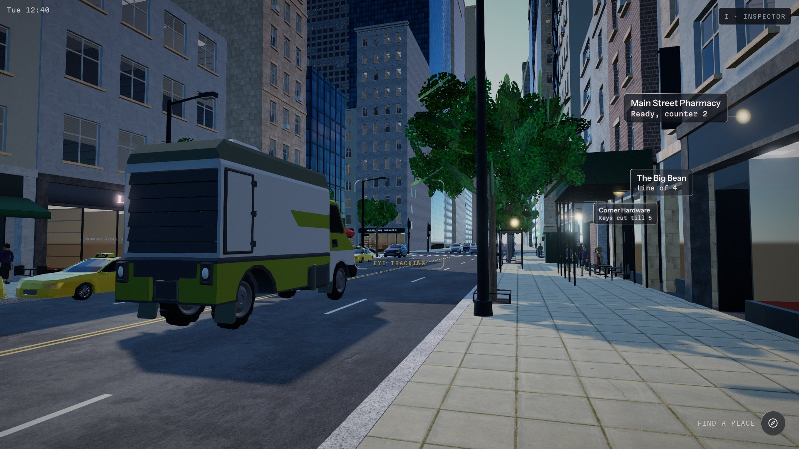
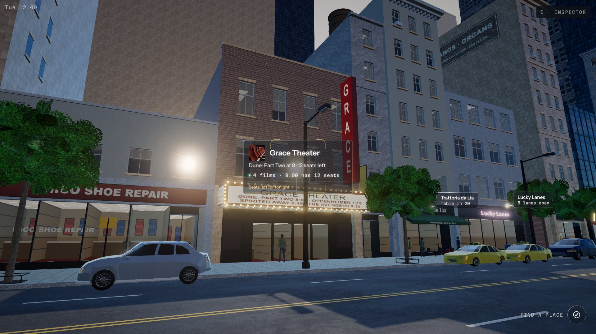
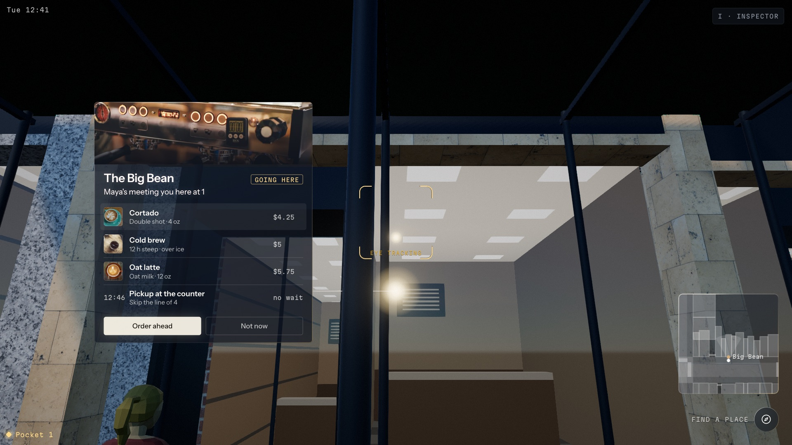
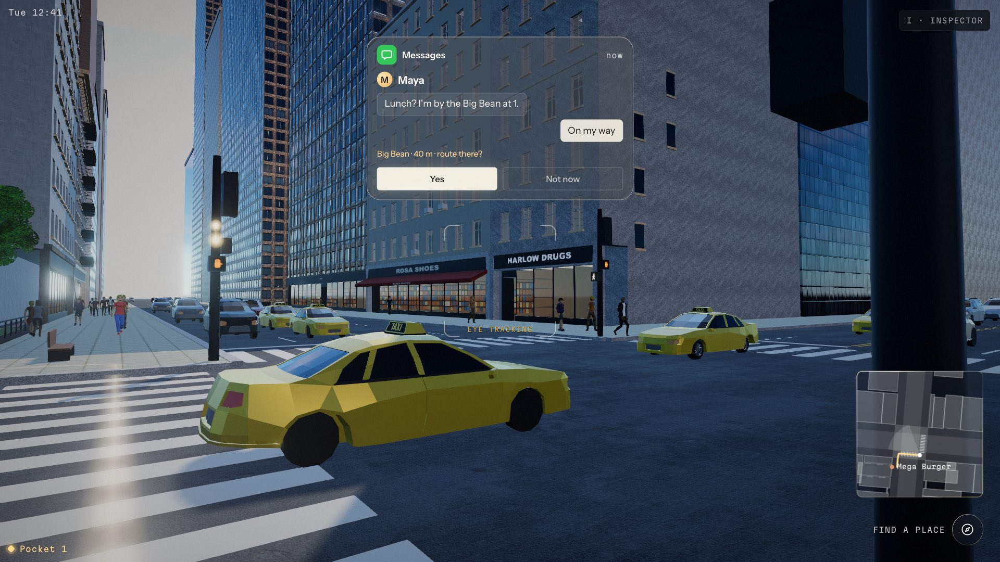
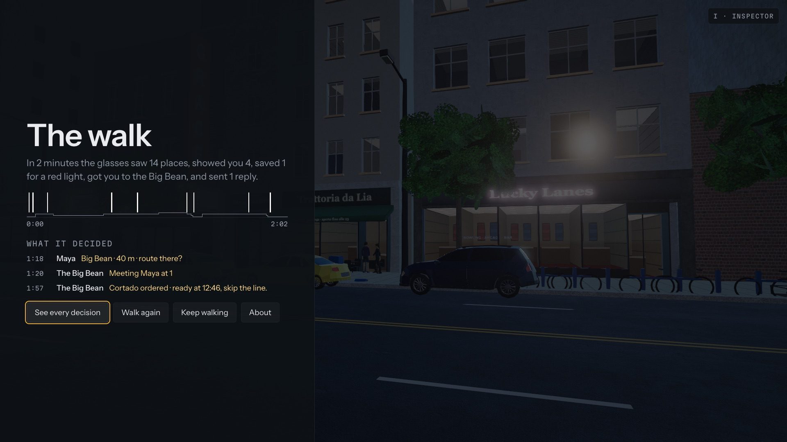
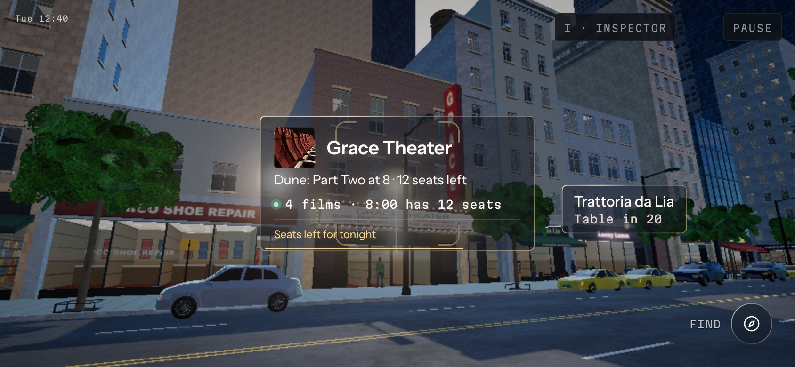
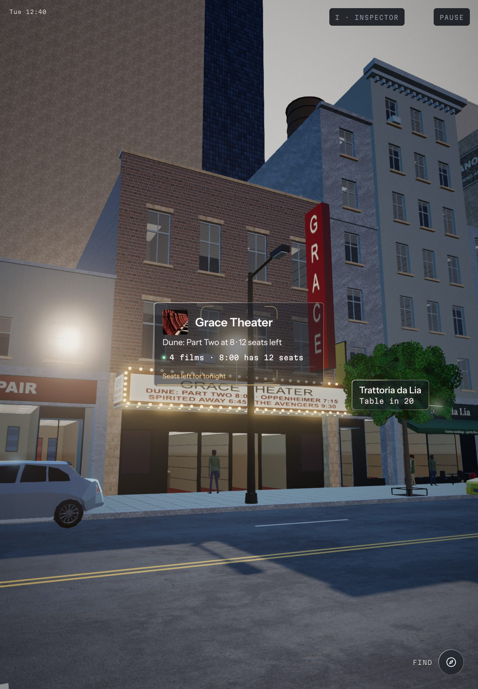

# Proactive UI for AI Glasses

*A UX study in when an assistant should speak, and when it should stay quiet.*

A city street seen through a near-future pair of AI glasses, wired into a deterministic decision engine that chooses what to show a person as they walk, how much, and when to stay quiet.

The street is one block that loops, rendered in real time in Three.js. The wearer walks it on rails and looks where they like. A viewfinder at the center of the view stands in for eye tracking: whatever it rests on is drawn slowly into it, a label grows to a card and a card to its expanded view while the look holds, and looking away shrinks it again. Under the glass a rules engine reads the wearer's pace, where they look, the traffic and the people around them, their messages and their goal, and decides every frame what the glasses may show. The interface follows a set of walking rules built for someone who is moving: content shrinks as they speed up, yields when they check for traffic, saves itself for the red light, and steps out of the way of anything real. Every decision is logged with its reason, replayable in an inspector, and scored by an eval suite. Built as a portfolio study in proactive interface design.


| | |
| --- | --- |
|  |  |
|  |  |
|  |  |


| | |
| --- | --- |
|  |  |

## What you can do in it

- **Two walks.** Explore lets you wander the block and look at anything; Lunch opens the menu on Food and gets you to lunch. Both loop around the block until you end them.
- **Look.** Drag to turn your head. The square in the middle is the eye tracker real glasses would have (`EYE TRACKING`). When the view settles, every place in sight shows its label; rest the square on one and it grows into its card after half a second, and into its expanded view after two seconds more, at any pace short of brisk. The card you hold is drawn slowly into the center and stays there while you rest on it; the others drift out of the way. Turn off it and it is a label again half a second later, and resting on the building does not bring it back.
- **Find a place.** `FIND A PLACE` at the bottom right lists places by category and walk time. Choose one and the route draws on the pavement, a map tile keeps the way, and the wearer walks there.
- **Texts that change the walk.** Messages arrive as banners at the top. Reply to Maya and the glasses offer to route you to her; say yes and the walk goes there.
- **The door and the choice.** At the door the place's expanded view stands beside the opening, never over it. Move the square down its rows and the row under it lifts; a click, Space or Enter chooses it (order the Cortado, hold a table, book a lane).
- **The pocket.** A pinch while walking opens nothing; it saves the place for the next red light, where the pocket surfaces what you saved with the seconds you have.
- **The end panel and the inspector.** End the walk for a one-sentence summary, a timeline and the decisions that mattered. Press I at any time for the inspector: every decision with its reason, the log scrubbable, the signals live, overrides, the eval report and an export.

## Run it

```
pnpm install
pnpm dev          # the demo at http://localhost:5173
pnpm build        # typecheck, evals, then a static site in apps/web/dist
```

No keys, no environment variables, no server, no model calls. `apps/web/dist` runs from any static file server.

Controls: drag to look; click, Enter or Space to choose (the pinch); right-click or Esc to dismiss; Space pauses when there is nothing to choose; I opens the inspector. `?scenario=walking` or `?scenario=hungry` skips the start screen; add `&scripted=1` to watch the scripted reviewer play the recorded walk. On touch screens: drag to look, tap to choose, long-press to dismiss; Pause and the inspector sit in the corners. Phones play in landscape; iPads play either way. Browsers without WebGL 2 get a short page saying what this is.

## Deploy

`pnpm build` writes `apps/web/dist` with relative paths, so it works at a domain root or under a subpath (GitHub Pages, Netlify, Vercel, any static host). Link previews use `social.jpg`; some crawlers want an absolute URL, so once the site has its address, put it in front of `social.jpg` in the two image tags in `apps/web/index.html`.

## How the brain works

The brain (`packages/brain`) is a rules policy, not a model. Ten times a second it takes a `WorldSnapshot` (pace, gaze and dwell, the crosswalk and its signal, nearby vehicles and people, social context, the goal, the inbox, what the glass actually showed) and returns decisions: show, hold, promote, demote, dismiss, save or surface, each with a level (pip, label, card, expanded, whisper), a timing, a placement hint, a cause and a reason made of signed parts.

Each tick runs in a fixed order:

1. **Pace band** from speed, with hysteresis: Stopped, Stroll, Walk, Brisk.
2. **Gates** that beat everything: a crossing or a vehicle near the path (the glass steps back and the safety text shows), a person on the path, snooze, an empty attention budget.
3. **Candidates and score**: relevance to the goal × value from the world × proximity × novelty − cost, where cost rises with pace and with what is already open.
4. **The ladder**: a settled view lights the labels of the places in sight; a held look grows the one under the center to its card and then its expanded view; looking away shrinks it to its label; Brisk allows labels only.
5. **The pocket, the reading budget, timing and hysteresis**, then placement hints for the overlay.

Same inputs, same decisions, every run: no `Math.random`, no wall clock, a seeded sim. That is what makes the inspector's replay and the eval suite exact. The full spec is `docs/brain-spec.md`.

The overlay (`packages/overlay`) renders the decisions: dark glass panes with a light edge, a light vocabulary (pip, aura, flare, leader) that lives in the scene and is hidden by real things, and a motion vocabulary where every move shows its cause and nothing bounces. It owns the geometry of the walking rules: the focus zone, the pull of the held pane, yielding to a head check, stepping aside for people and cars, the doorway kept clear, backdrop adaptivity.

## The walking rules

The center of the project is `docs/walking-rules.md`.

| Rule | Trigger | What the glasses do |
| --- | --- | --- |
| 1 · Speed-scaled focus zone | Every frame | The clear center of view grows with pace, from 33 × 40% Stopped to 52 × 58% Brisk; the held pane is the exception, drawn slowly into the viewfinder while the wearer rests on it |
| 2 · Reading budget | A show while moving | A label is the name and three words and a number; the reason line stays in the log while walking; no card in Walk without its hold |
| 3 · Auto-fold | A proactive label not looked at | Folds itself after 2.5 s in Walk, 4 s in Stroll; nothing waits to be dismissed |
| 4 · Entry | A new show | A pane is born beside its light with the condense move, never sliding in from the edge; while moving, outside the focus zone unless looked at |
| 5 · Head-scan yielding | A fast head turn near a curb | Content on that side fades to 15% and slides 24 px out in 180 ms, and comes back in 320 ms when the check is over |
| 6 · The pocket | A pinch while walking | Nothing opens; the place is saved and "Saved" shows at its light |
| 7 · The pocket surfaces at the pause | Stopped 2 s with at least 6 s available | "12 s · what you saved" grows beside the held glyph |
| 8 · The world has right of way | A person or vehicle over a pane | The pane dims and steps aside, or waits as its light; a face is never covered |
| 9 · Backdrop adaptivity | Every 250 ms | The glass deepens and the type thickens over bright façades; text never below 4.5:1 |
| 10 · Labels, then one card | The view settles, or a look rests | Labels for every place in sight; the one under the center grows to its card after 0.5 s and to its expanded view after 2 s more, in every band but Brisk; turning off it shrinks it to its label 0.5 s later |
| 11 · The whisper channel | Brisk | One captioned line at the bottom edge for 2.5 s instead of a pane |
| 12 · Snooze | Looking up at nothing for 2 s | Everything folds; the glyph counts down 60 s |
| 13 · The budget is visible | Always, in the inspector | Seven proactive shows per walk, one back per 40 s of quiet; looks, choices and arrivals are free |

## How the evals work

`pnpm eval` is the real test suite (`packages/evals`, `docs/evals.md`): 44 suites and 1020 checks on this build. It runs the two recorded walks and 41 focused cases (one or more per walking rule, the gates, notifications, proactive moments) through the brain headless in Node, and scores them against hand-written expectations: what must happen in each time window, what must not, show limits, and the brain's state frame by frame. Every run also checks global invariants: every reason cites an allowed kind and never the wearer's body, eyes or habits; no em dash anywhere; every decision in a crossing is a hold; the focus zone stays clear on the overlay's own pane rects; the budget meter matches the show count; two runs produce identical logs. The report lands in `packages/evals/report/latest.json`, and the inspector's Evals tab shows it.

The inspector's Export writes a run (snapshots, overrides, decision log) in the eval format. `pnpm eval --file <export>` replays it through a fresh brain, checks that it reproduces the exported decisions exactly, and runs every invariant on it, so a session someone played by hand can be scored like a scripted one.

`pnpm test` runs the lean unit tests (61), including the overlay's placement suite, the yield and step-aside timings, and legibility against the brightest and darkest façades.

The live behaviour is measured in a real browser, playing the demo the way a person does:

- `pnpm aim` plays two laps of Explore and aims at labels and cards with real drags, at Stroll and at Walk: whether the look holds the place aimed at, whether the pane is drawn in, whether anything jumps, and that the pane does not move by a pixel when the look lands or while the pointer is down.
- `pnpm doors` visits all fourteen places through the menu, walks to each door, holds the look, walks the rows with the viewfinder and chooses: how long the expanded view was on the glass, which rows lifted, and the confirmation.
- `sh scripts/barall.sh http://localhost:5173/` runs the bar (`scripts/bar.ts`) on both walks at 1920 × 1080 and 3840 × 2160: level changes, births, panes off their lights or over the road or the chrome, labels per settle, the look probes and console errors.
- `pnpm shots --scenario hungry --times 14,62,117` takes stills at walk times, and `scripts/devices.ts` renders the start screen and three beats on thirteen screens from a 390 px phone to 4K.

## Repository

```
apps/web            the demo: world renderer, start screen, walk loop, end panel, chrome
packages/brain      the decision engine (no DOM, no Three)
packages/sim        the block, routes, traffic, people, signals, scripted beats, backdrop sampler
packages/overlay    the glasses layer
packages/inspector  the reviewer's drawer
packages/evals      scenarios, expectations, runner, report
packages/shared     types, data, placement, camera and signal helpers
data/               the places, their copy and photographs, and the walk's beats
docs/               the specs this was built from
reference/          the approved prototypes
scripts/            aim, doors, the bar, shots, devices and the other live checks
STATUS.md           the build log
```

## Credits

Built by Brandon Church. Three.js, GSAP, TypeScript. Textures from ambientCG, people and cars by Quaternius, place photographs via Openverse, all CC0; fonts under the OFL. Every asset is listed in `LICENSES.md`.
